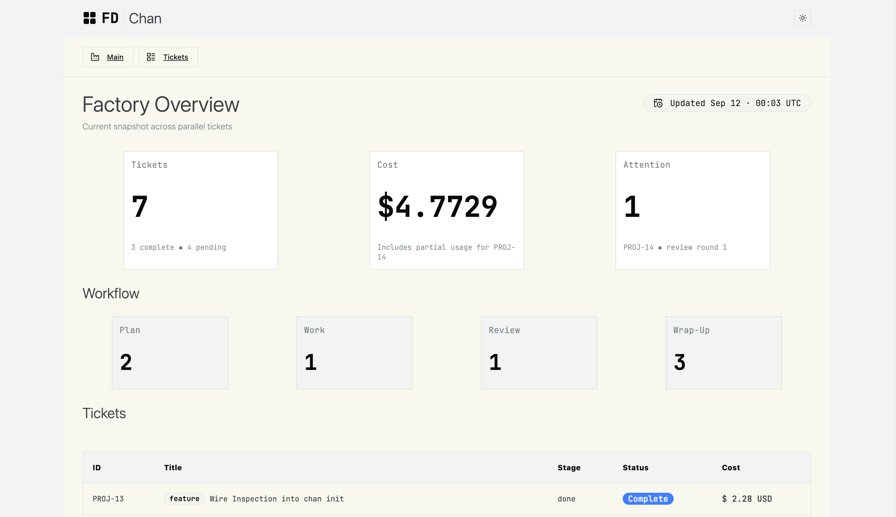

# Factory Dashboard

A web dashboard for one [factory](https://github.com/geut/factory-skills): see every ticket, how far it has got, its tasks and what blocks them, and what needs a person, without leaving the browser.

It ships with the [factory sandbox](https://github.com/geut/sbx-shell-pi) as an optional kit. The factory works without it; the dashboard is a window onto it and a few controls.



- [Quickstart: the factory sandbox](#quickstart-the-factory-sandbox)
- [How the dashboard connects to the factory](#how-the-dashboard-connects-to-the-factory)
- [Using the dashboard](#using-the-dashboard)
- [Troubleshooting](#troubleshooting)
- [Local development](#local-development)

## Quickstart: the factory sandbox

You need Docker Desktop and `sbx` 0.47 or newer ([install `sbx`](https://docs.docker.com/ai/sandboxes/)). Each step says where to run it: **host** is your computer, **sandbox** is a Herdr pane inside the sandbox.

These steps are the [sbx-shell-pi factory setup](https://github.com/geut/sbx-shell-pi#set-up-the-factory) with the dashboard kit included. That README is the reference for the sandbox itself.

### 1. Allow the kit sources (host)

`sbx` only installs kits from sources on its allowlist, and by default that is Docker Hub alone. Allow the factory (`ghcr.io/geut/`) and the dashboard (`ghcr.io/dpaez/`):

```bash
sbx settings set kit.allowedSources '["docker.io/","ghcr.io/geut/","ghcr.io/dpaez/"]'
```

This replaces the whole list. If `sbx settings get kit.allowedSources` already shows other sources, keep them in the new list.

### 2. Create the sandbox with the dashboard (host)

```bash
sbx run --name factory ghcr.io/geut/sbx-shell-pi:node-24-factory /path/to/project \
  --kit ghcr.io/dpaez/sbx-kit-factory-dashboard:0.2.0
```

The `--kit` line adds the dashboard. The kit set is fixed when the sandbox is created, so adding the dashboard later means creating a new sandbox.

When the sandbox starts, you land in **Herdr**, a terminal multiplexer where the agents run side by side. The agents also need your model provider key: see [step 3 of the sbx-shell-pi setup](https://github.com/geut/sbx-shell-pi#3-add-your-model-provider-key).

### 3. Configure and start the factory (sandbox)

In the Herdr pane, from your project's root:

```bash
cd "$WORKSPACE_DIR"   # your project, if you're not already there
factory-up
```

The first time, this creates `.factory/FACTORY.json` with starter settings, then starts the factory server in a Herdr workspace named `factory`. Open `.factory/FACTORY.json` and check the models (`models.work` and `models.review`) before going on. The [factory-skills README](https://github.com/geut/factory-skills#factory-root) explains every setting.

Then start `pi` in a pane and run:

```text
/factory start
```

### 4. Open the dashboard (host)

The dashboard is already running: you don't start it. Find its host port:

```bash
sbx ports factory
```

Open `http://localhost:<port>` in your browser, where `<port>` is the host port listed for `factory-dashboard`. Don't use the one for `factory-api`: that is the factory server, not the dashboard.

### What runs by itself, and what you run

| Automatic                                                                                                                           | You run                                           |
| ----------------------------------------------------------------------------------------------------------------------------------- | ------------------------------------------------- |
| The dashboard starts on every boot, on container port `7732`, and restarts if it stops.                                             | `factory-up`, once per project (step 3).          |
| After a restart (`sbx stop`, then `sbx run factory`), the factory server starts again once Herdr is up, if `factory-up` ran before. | `/factory start` in pi, to process tickets.       |
| The dashboard picks up a new token without a restart.                                                                               | `sbx ports factory` on the host, to find the URL. |

Before `factory-up` has run, the dashboard shows a page asking you to run it. Reload once you have.

## How the dashboard connects to the factory

`factory-up` writes `.factory/dashboard.env` (mode `0600`) at the project root:

```bash
FACTORY_API_URL=http://127.0.0.1:7731
FACTORY_API_TOKEN=...   # an act token for the "dashboard" client
```

The dashboard reads that file on every request, so when `factory-up` replaces a rejected token, the next page load uses the new one. No restart is needed. A non-empty `FACTORY_API_URL` or `FACTORY_API_TOKEN` environment variable wins over the file.

The dashboard calls the factory from its own server. The token never reaches the browser: your browser only talks to the dashboard.

Two ports, two jobs:

| Name in `sbx ports` | Container port | What it is                                                                                        |
| ------------------- | -------------- | ------------------------------------------------------------------------------------------------- |
| `factory-dashboard` | `7732`         | The dashboard. Open this one in the browser.                                                      |
| `factory-api`       | `7731`         | The factory server's API. The dashboard reaches it inside the sandbox at `http://127.0.0.1:7731`. |

The dashboard only uses the factory's HTTP API; it never opens the factory's files or database ([ADR 0005](./docs/adr/0005-factory-api-client-and-command-center.md)).

## Using the dashboard

The top bar has **Flow board**, **Tickets**, **Stats** and **New ticket**, plus the live connection status.

- **Flow board** (`/`): one lane per stage (Plan, Work, QA, Review, Handoff), with a card per ticket showing its status and task progress. The backlog lane lists tracker issues you can **Start**; an issue that waits on another says "Blocked by" and which one. Select a card to open the ticket in a side panel; **Open ticket** goes to its full page.
- **Tickets** (`/tickets`): every ticket in a sortable list.
- **A ticket's page** (`/tickets/<key>`): the current stage and status, the tasks with their progress and which tasks block them, the run timeline, evidence, and usage. Earlier executions stay readable.
- **Needs attention**: when an agent asks a question or waits for approval, its card says **Needs attention** and the strip above the board counts those tickets and gives the reasons. **Open next** steps through them. On the ticket, read the question and answer it with **Send reply & resume**.
- **Ticket actions**, on the current execution, when they apply:
  - **Stop agent** stops a running agent (choose the run when several are active).
  - **Retry** relaunches the step that stopped, reusing its context. It is not a new execution.
  - **Cancel execution** ends the current execution, after you confirm.
  - **Mark complete** records that the handoff is done. It does not merge the pull request.
  - **Rerun** starts a new execution from a fresh copy of the source.
- **New ticket** (`/new`): describe a ticket and **Start planning**.
- **Stats** (`/stats`): cost, time and outcome figures for executions started in a time window.

**Live updates.** Pages update as the factory reports changes; there's no need to reload. The status in the top bar reads **Live** while connected, **Connecting** or **Reconnecting** while it tries, **Disconnected** when the event stream stopped (data may be out of date), and **Authentication failed** when the factory refused the token. Disconnected and Authentication failed offer **Retry**.

**Go back to pi or Herdr** to start the factory (`/factory start`), to change `FACTORY.json`, to watch an agent work or talk to it beyond a reply, to review diffs, and to merge pull requests. The dashboard doesn't do those.

## Troubleshooting

**"The dashboard cannot reach the factory with its configuration", with "Missing FACTORY_API_URL and FACTORY_API_TOKEN".**
`.factory/dashboard.env` doesn't exist yet. In the sandbox, run `factory-up` from the project root, then reload the page.

**The same configuration page while `.factory/dashboard.env` exists, or "Authentication failed" in the top bar.**
The factory rejected the token (unauthorized or missing the `act` scope), for example after it was revoked. In the sandbox, run `factory-up` again: it replaces a token the server rejects. Reload; no restart is needed. If you set `FACTORY_API_TOKEN` in the environment yourself, that value wins over the file, so fix or remove it.

**"The factory server is unreachable or answered unexpectedly", or "Disconnected" in the top bar.**
The factory server isn't running. After a restart it only comes back once Herdr is up, so attach with `sbx run factory`. Check the `factory` workspace in Herdr; if the server isn't there, run `factory-up` in the sandbox. The restart log is `~/.local/state/factory/autostart.log`.

**The dashboard port can't be opened.**

- `sbx ports factory` lists no `factory-dashboard`: the sandbox was created without `--kit ghcr.io/dpaez/sbx-kit-factory-dashboard:0.2.0`. Create a new sandbox with it.
- `sbx run` refused the kit: its source isn't allowed. Repeat [step 1](#1-allow-the-kit-sources-host).
- The port is listed but the browser can't connect: check that the sandbox is running (`sbx ls`), and that you used the `factory-dashboard` port, not `factory-api`. In the sandbox, `curl -fsS http://127.0.0.1:7732/` shows whether the dashboard answers, and its log is `~/.local/state/factory-dashboard/dashboard.log`.

## Local development

To work on the dashboard itself, run it from a checkout against a running factory. You need Node 24 and `pnpm`.

1. **Install:**

   ```bash
   pnpm install
   ```

2. **Point it at a factory.** The easiest way is the `.factory/dashboard.env` that `factory-up` wrote in the project you want to watch:

   ```bash
   export FACTORY_DASHBOARD_ENV_FILE=/path/to/project/.factory/dashboard.env
   ```

   Or copy `.env.example` to `.env` and set `FACTORY_API_URL` (without `/v1`, for example `http://127.0.0.1:7731`) and `FACTORY_API_TOKEN` (an `act` token). `FACTORY_OPERATOR_NAME` is optional; it's sent with commands. A non-empty variable wins over the env file. These variables stay on the dashboard's server.

3. **Run:**

   ```bash
   pnpm dev   # http://localhost:5173
   ```

Tests never need a factory. Before a change is done: `pnpm check && pnpm lint && pnpm test`, and `pnpm test:e2e` for user paths.

More for contributors:

- [`docs/development.md`](./docs/development.md): Storybook, the test commands and the factory API contract (`pnpm api:sync`).
- [`test/README.md`](./test/README.md): test layers, the end-to-end fixture and fake factory.
- [`docs/factory-dashboard-specs/`](./docs/factory-dashboard-specs/): product and UI specs. [`GLOSSARY.md`](./GLOSSARY.md) and [`DESIGN.md`](./DESIGN.md) hold the vocabulary and visual rules.
- [ADR 0005](./docs/adr/0005-factory-api-client-and-command-center.md): why the dashboard is a factory API client.
- [`docs/releasing.md`](./docs/releasing.md): releasing the app and the kit.

Stack: SvelteKit (adapter-node), Svelte 5, shadcn-svelte, Tailwind CSS 4, TypeScript and `openapi-fetch`.
